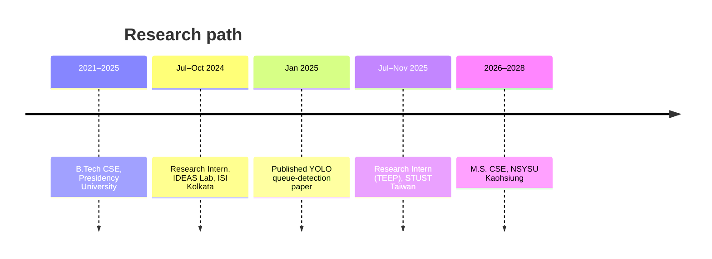

  

---

## 👋 About me

I'm an **M.S. student in Computer Science & Engineering at National Sun Yat-sen University (NSYSU), Kaohsiung**. I build ML systems that detect threats and anomalies in network traffic, video and sensor data, and I focus on explaining *why* a model made a decision, not only how accurate it is.

- 📍 Kaohsiung, Taiwan
- 🎓 NSYSU M.S. CSE (2026–2028) · Presidency University B.Tech CSE (CGPA 8.61/10)
- 🔎 **Looking for:** research / engineering internships in AI-based threat detection, security analytics and applied ML (winter break 2026–27)
- 🔬 **Interested in:** AI-based intrusion and APT detection, security for AI systems, explainable AI

---

## 🛠️ Tech stack

 

 

Also: SHAP · Grad-CAM · LIME · Hugging Face Transformers · LoRA/QLoRA · RAG · YOLO · imbalanced-learn · SciPy · Mapbox · Deck.gl

---

## 🚀 Featured projects

<table>
<tr>
<td width="50%" valign="top">

### 🔐 [ML-Based Network Intrusion Detection](https://github.com/Pra-gg10768/ml-network-intrusion-detection)

Random Forest and XGBoost ensembles on **CICIDS2017**, with SHAP to show which network-traffic features drive each prediction.

**Result:** 98%+ detection rate

</td>
<td width="50%" valign="top">

### 🕵️ [Physio-Aware Deepfake Detection](https://github.com/Pra-gg10768/physio-aware-deepfake-detection)

Multi-ROI rPPG framework modeling temporal and spectral pulse consistency across facial regions.

**Result:** 93.6% accuracy · 0.955 AUC on DFD-Original

</td>
</tr>
<tr>
<td width="50%" valign="top">

### 👁️ Real-Time Queue Detection & Management

End-to-end YOLO pipeline for queue and crowd analysis under occlusion, scale variation and lighting changes.

**Result:** [Published, IJSREM 2025](https://doi.org/10.55041/IJSREM40695)

</td>
<td width="50%" valign="top">

### 🚗 GPS + OBD-II Trip Visualization

Telemetry pipeline with timestamp sync, cleaning, geodesic speed estimation, automatic stop detection and interactive 3D route animation.

**Context:** built at STUST (TEEP research internship)

</td>
</tr>
</table>

<!-- TODO: add repo links for YOLO, GPS/OBD-II and sign-language projects once public; add precision/recall/F1/FPR for the NIDS project -->

<b>More: Video-based facial expression & sign language recognition</b>

Models temporal facial movement and combines frame-level visual features with spatio-temporal hand and body-motion analysis to recognize expressions and isolated signs.

---

## 🧭 Research & experience

- **TEEP Research Intern, STUST (Jul–Nov 2025):** modular GPS/OBD-II telemetry pipeline and 3D spatio-temporal visualization on noisy, misaligned sensor data.
- **Research Intern, ISI Kolkata (Jul–Oct 2024):** Python backend logic and structured data pipelines for the Upatto project; formal training in research methodology.

---

## 🏆 Certifications & achievements

- 🛡️ Fortinet Certified Fundamentals in Cybersecurity (NSE 1 & 2) · IBM Python for Data Science · IBM Machine Learning with Python · MATLAB for Data Processing and Visualization
- 🥇 Winner, Smart India Hackathon (Internal) 2023 · Runner-up, SCIMIT Project Expo 2024 · Top 4, InnovateX Idea Expo, IISc Bengaluru
- 🤝 Student Mentor, Build Club: guided 20 first-year students through IoT projects

---

## 📊 GitHub activity

<!-- Contribution snake: shows after you add the workflow in .github/workflows/snake.yml and run it once -->
<picture>
  <source media="(prefers-color-scheme: dark)" srcset="https://raw.githubusercontent.com/Pra-gg10768/Pra-gg10768/output/github-snake-dark.svg" />
  <source media="(prefers-color-scheme: light)" srcset="https://raw.githubusercontent.com/Pra-gg10768/Pra-gg10768/output/github-snake.svg" />
  
</picture>

---

## 📫 Let's connect

I'm open to internships and research collaborations in AI-based security and applied ML.

