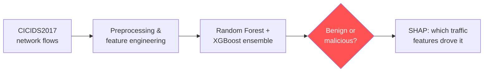
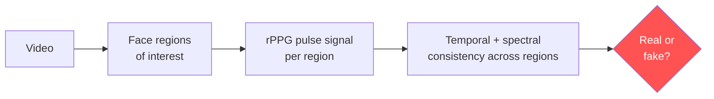
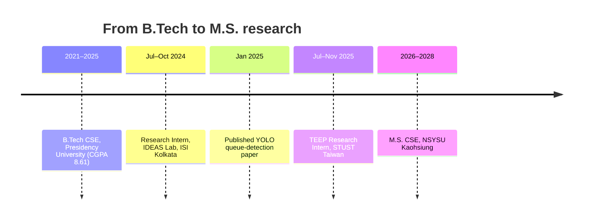

 

> [!NOTE]
> **Open to winter 2026–27 internships in Kaohsiung**: AI-based threat detection, security analytics and applied ML. Interested in intrusion / APT detection and security for AI systems.

## 📈 At a glance

| **98%+** | **0.955** | **1** | **2** | **20** |
|:---:|:---:|:---:|:---:|:---:|
| detection rate on CICIDS2017 | AUC on DFD-Original | peer-reviewed paper (2025) | research internships | first-year students mentored |

## 🛠️ Toolbox

 

 

Also: SHAP · Grad-CAM · LIME · Hugging Face Transformers · LoRA/QLoRA · RAG · YOLO · imbalanced-learn · SciPy · Mapbox · Deck.gl

## 🚀 Featured projects

<table>
<tr>
<td width="50%" valign="top">

### 🔐 [Network Intrusion Detection](https://github.com/Pra-gg10768/ml-network-intrusion-detection)

Random Forest + XGBoost ensembles on **CICIDS2017**, with SHAP to show which traffic features drive each prediction.

**98%+ detection rate**

</td>
<td width="50%" valign="top">

### 🕵️ [Physio-Aware Deepfake Detection](https://github.com/Pra-gg10768/physio-aware-deepfake-detection)

Multi-ROI rPPG framework that checks whether a face's pulse signal stays consistent over time and frequency.

**93.6% accuracy · 0.955 AUC**

</td>
</tr>
<tr>
<td width="50%" valign="top">

### 👁️ Real-Time Queue Detection

End-to-end YOLO pipeline for queue and crowd analysis under occlusion, scale variation and lighting changes.

**[Published, IJSREM 2025](https://doi.org/10.55041/IJSREM40695)**

</td>
<td width="50%" valign="top">

### 🚗 GPS + OBD-II Trip Visualization

Telemetry pipeline with timestamp sync, cleaning, geodesic speed estimation, stop detection and 3D route animation.

**Built at STUST (TEEP)**

</td>
</tr>
</table>

<b>🔎 How the detection pipelines work (click to expand)</b>

 

**Network intrusion detection**

**Physio-aware deepfake detection**

<b>🎭 Also: video-based facial expression & sign language recognition</b>

 

Models temporal facial movement and combines frame-level visual features with spatio-temporal hand and body-motion analysis to recognize expressions and isolated signs.

<!-- TODO: add repo links for the YOLO, GPS/OBD-II and sign-language projects once public; add precision/recall/F1/FPR for the NIDS project; check the two diagrams match your real pipelines -->

## 🧭 Research path

<b>What I did in each role</b>

 

- **TEEP Research Intern, STUST (Jul–Nov 2025):** modular GPS/OBD-II telemetry pipeline and interactive 3D spatio-temporal visualization on noisy, misaligned sensor data.
- **Research Intern, ISI Kolkata (Jul–Oct 2024):** Python backend logic and structured data pipelines for the Upatto project; formal training in research methodology and analytics.

## 🏆 Certifications & achievements

- 🛡️ Fortinet Certified Fundamentals in Cybersecurity (NSE 1 & 2) · IBM Python for Data Science · IBM Machine Learning with Python · MATLAB for Data Processing and Visualization
- 🥇 Winner, Smart India Hackathon (Internal) 2023 · Runner-up, SCIMIT Project Expo 2024 · Top 4, InnovateX Idea Expo, IISc Bengaluru
- 🤝 Student Mentor, Build Club: guided 20 first-year students through IoT projects

## 📊 GitHub activity

<!-- Snake appears after you add snake.yml (.github/workflows) and run it once -->
<picture>
  <source media="(prefers-color-scheme: dark)" srcset="https://raw.githubusercontent.com/Pra-gg10768/Pra-gg10768/output/github-snake-dark.svg" />
  <source media="(prefers-color-scheme: light)" srcset="https://raw.githubusercontent.com/Pra-gg10768/Pra-gg10768/output/github-snake.svg" />
  
</picture>

### 📫 Let's connect

I'm looking for research and engineering internships in AI-based security and applied ML.

